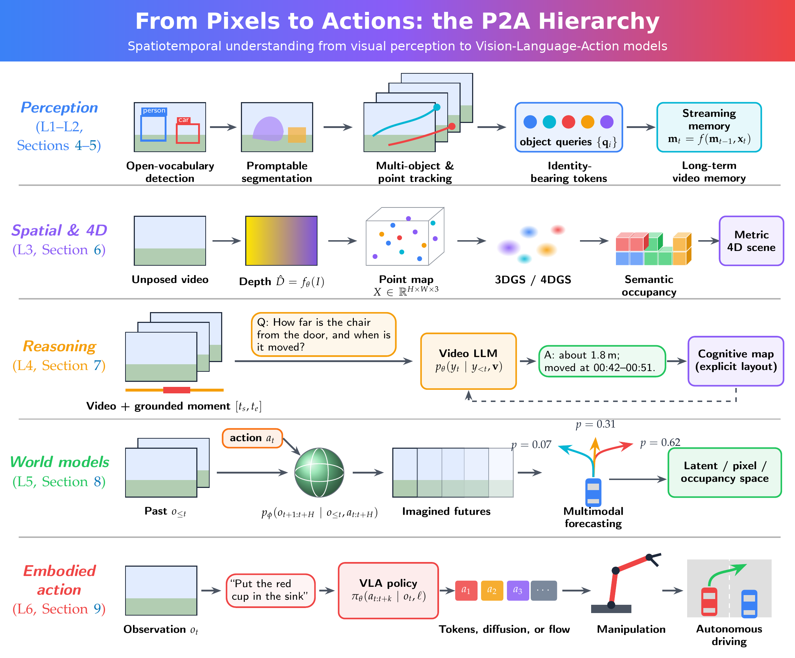

# Awesome Pixels-to-Actions (P2A) [](https://awesome.re)

A curated, continuously updated list of papers on **spatiotemporal understanding**, from visual perception to Vision-Language-Action (VLA) models, organized by the **Pixels-to-Actions (P2A) hierarchy** introduced in the review:

> **From Pixels to Actions: A Comprehensive Review of Spatiotemporal Understanding from Visual Perception to Vision-Language-Action Models.**
> Binay Kumar Singh and Niels Da Vitoria Lobo. *Journal of Imaging* (MDPI), Special Issue "From Visual Perception to Spatiotemporal Understanding" (under review).
> [Paper link — to be added on publication]



## The P2A hierarchy

| Level | Capability | Typical tasks |
|---|---|---|
| **L1** | Visual perception | Detection, segmentation, open-vocabulary grounding |
| **L2** | Temporal perception | Tracking, point tracking, video object segmentation |
| **L3** | Spatial & 4D understanding | Depth, pose, feed-forward 3D/4D reconstruction, occupancy |
| **L4** | Spatiotemporal reasoning | Video LLMs, temporal grounding, spatial reasoning in MLLMs |
| **L5** | Predictive world modeling | Video/occupancy world models, trajectory forecasting |
| **L6** | Embodied action | VLA models for manipulation, navigation, and driving |

Currently listed: **230 papers**, sorted newest first within each section. All entries were verified against arXiv, CVF, NeurIPS, OpenReview, PMLR, ACL Anthology, RSS, IEEE, Springer, Nature, and other publisher records (November 2026).

## Contents

- [Related Surveys](#related-surveys)
- [Foundations: Backbones, Alignment, Tokenization, Sequence Models](#foundations-backbones-alignment-tokenization-sequence-models)
- [L1 — Visual Perception](#l1--visual-perception)
- [L2 — Temporal Perception](#l2--temporal-perception)
- [L3 — Spatial and 4D Understanding](#l3--spatial-and-4d-understanding)
- [L4 — Spatiotemporal Reasoning](#l4--spatiotemporal-reasoning)
- [L5 — Predictive World Modeling](#l5--predictive-world-modeling)
- [L6 — Embodied Action (Robotics and Driving)](#l6--embodied-action-robotics-and-driving)
- [Applications: Medical, Remote Sensing, AR/VR, Surveillance, Digital Twins](#applications-medical-remote-sensing-arvr-surveillance-digital-twins)
- [Datasets and Benchmarks](#datasets-and-benchmarks)
- [Citation](#citation)
- [Contributing](#contributing)

## Related Surveys

| Year | Title | Venue | Link |
|---|---|---|---|
| 2026 | **A Survey on Video Temporal Grounding with Multimodal Large Language Model** — Jianlong Wu, Wei Liu, Ye Liu et al. | IEEE Trans. Pattern Anal. Mach. Intell. | [DOI](https://doi.org/10.1109/TPAMI.2025.3615586) |
| 2026 | **Efficiency and Temporal Reasoning in Transformer-Based Video Object Detection: A Systematic Review** — Yiannis Keravnos, Anastasia Ioannou, Andreas Papadopoulos et al. | J. Imaging | [DOI](https://doi.org/10.3390/jimaging12090419) |
| 2026 | **Vision-Language-Action in Robotics: A Survey of Datasets, Benchmarks, and Data Engines** — Ziyao Wang, Bingying Wang, Hanrong Zhang et al. | arXiv | [arXiv](https://arxiv.org/abs/2604.23001) |
| 2025 | **3D and 4D World Modeling: A Survey** — Lingdong Kong, Wesley Yang, Jianbiao Mei et al. | arXiv | [arXiv](https://arxiv.org/abs/2509.07996) |
| 2025 | **A Survey on Efficient Vision-Language-Action Models** — Zhaoshu Yu, Bo Wang, Pengpeng Zeng et al. | arXiv | [arXiv](https://arxiv.org/abs/2510.24795) |
| 2025 | **A Survey on Vision-Language-Action Models for Autonomous Driving** — Sicong Jiang, Zilin Huang, Kangan Qian et al. | arXiv | [arXiv](https://arxiv.org/abs/2506.24044) |
| 2025 | **A Survey on Vision-Language-Action Models for Embodied AI** — Yueen Ma, Zixing Song, Yuzheng Zhuang et al. | IEEE Trans. Neural Netw. Learn. Syst. | [DOI](https://doi.org/10.1109/TNNLS.2025.3650584) · [arXiv](https://arxiv.org/abs/2405.14093) |
| 2025 | **A Survey on Vision-Language-Action Models: An Action Tokenization Perspective** — Yifan Zhong, Fengshuo Bai, Shaofei Cai et al. | arXiv | [arXiv](https://arxiv.org/abs/2507.01925) |
| 2025 | **An Anatomy of Vision-Language-Action Models: From Modules to Milestones and Challenges** — Chao Xu, Suyu Zhang, Yang Liu et al. | arXiv | [arXiv](https://arxiv.org/abs/2512.11362) |
| 2025 | **Large VLM-based Vision-Language-Action Models for Robotic Manipulation: A Survey** — Rui Shao, Wei Li, Lingsen Zhang et al. | arXiv | [arXiv](https://arxiv.org/abs/2508.13073) |
| 2025 | **Pure Vision Language Action (VLA) Models: A Comprehensive Survey** — Dapeng Zhang, Jing Sun, Chenghui Hu et al. | arXiv | [arXiv](https://arxiv.org/abs/2509.19012) |
| 2025 | **Reconstructing 4D Spatial Intelligence: A Survey** — Yukang Cao, Jiahao Lu, Zhisheng Huang et al. | arXiv | [arXiv](https://arxiv.org/abs/2507.21045) |
| 2025 | **Video Understanding with Large Language Models: A Survey** — Yunlong Tang, Jing Bi, Siting Xu et al. | IEEE Trans. Circuits Syst. Video Technol. | [DOI](https://doi.org/10.1109/TCSVT.2025.3566695) |
| 2025 | **Vision-Language-Action (VLA) Models: Concepts, Progress, Applications and Challenges** — Ranjan Sapkota, Yang Cao, Konstantinos I. Roumeliotis et al. | arXiv | [arXiv](https://arxiv.org/abs/2505.04769) |
| 2024 | **From Seconds to Hours: Reviewing MultiModal Large Language Models on Comprehensive Long Video Understanding** — Heqing Zou, Tianze Luo, Guiyang Xie et al. | arXiv | [arXiv](https://arxiv.org/abs/2409.18938) |
| 2022 | **Event-Based Vision: A Survey** — Guillermo Gallego, Tobi Delbruck, Garrick Orchard et al. | IEEE Trans. Pattern Anal. Mach. Intell. | [DOI](https://doi.org/10.1109/TPAMI.2020.3008413) |

## Foundations: Backbones, Alignment, Tokenization, Sequence Models

| Year | Title | Venue | Link |
|---|---|---|---|
| 2024 | **DINOv2: Learning Robust Visual Features without Supervision** — Maxime Oquab, Timothee Darcet, Theo Moutakanni et al. | Trans. Mach. Learn. Res. |  |
| 2024 | **InternVideo2: Scaling Foundation Models for Multimodal Video Understanding** — Yi Wang, Kunchang Li, Xinhao Li et al. | ECCV | [DOI](https://doi.org/10.1007/978-3-031-73013-9_23) |
| 2024 | **Language Model Beats Diffusion – Tokenizer is Key to Visual Generation** — Lijun Yu, Jose Lezama, Nitesh B. Gundavarapu et al. | ICLR |  |
| 2024 | **LLaMA-VID: An Image is Worth 2 Tokens in Large Language Models** — Yanwei Li, Chengyao Wang, Jiaya Jia | ECCV | [DOI](https://doi.org/10.1007/978-3-031-72952-2_19) |
| 2024 | **Mamba: Linear-Time Sequence Modeling with Selective State Spaces** — Albert Gu, Tri Dao | COLM |  |
| 2024 | **MovieChat: From Dense Token to Sparse Memory for Long Video Understanding** — Enxin Song, Wenhao Chai, Guanhong Wang et al. | CVPR |  |
| 2024 | **Qwen2-VL: Enhancing Vision-Language Model's Perception of the World at Any Resolution** — Peng Wang, Shuai Bai, Sinan Tan et al. | arXiv | [arXiv](https://arxiv.org/abs/2409.12191) |
| 2024 | **Revisiting Feature Prediction for Learning Visual Representations from Video** — Adrien Bardes, Quentin Garrido, Jean Ponce et al. | Trans. Mach. Learn. Res. |  |
| 2024 | **RoFormer: Enhanced Transformer with Rotary Position Embedding** — Jianlin Su, Murtadha Ahmed, Yu Lu et al. | Neurocomputing |  |
| 2024 | **VideoMamba: State Space Model for Efficient Video Understanding** — Kunchang Li, Xinhao Li, Yi Wang et al. | ECCV | [DOI](https://doi.org/10.1007/978-3-031-73347-5_14) |
| 2024 | **Vision Mamba: Efficient Visual Representation Learning with Bidirectional State Space Model** — Lianghui Zhu, Bencheng Liao, Qian Zhang et al. | ICML |  |
| 2023 | **BLIP-2: Bootstrapping Language-Image Pre-training with Frozen Image Encoders and Large Language Models** — Junnan Li, Dongxu Li, Silvio Savarese et al. | ICML |  |
| 2023 | **Occ3D: A Large-Scale 3D Occupancy Prediction Benchmark for Autonomous Driving** — Xiaoyu Tian, Tao Jiang, Longfei Yun et al. | NeurIPS D&B |  |
| 2023 | **Sigmoid Loss for Language Image Pre-Training** — Xiaohua Zhai, Basil Mustafa, Alexander Kolesnikov et al. | ICCV | [DOI](https://doi.org/10.1109/ICCV51070.2023.01100) |
| 2023 | **Token Merging: Your ViT But Faster** — Daniel Bolya, Cheng-Yang Fu, Xiaoliang Dai et al. | ICLR |  |
| 2023 | **Visual Instruction Tuning** — Haotian Liu, Chunyuan Li, Qingyang Wu et al. | NeurIPS |  |
| 2022 | **BEVFormer: Learning Bird's-Eye-View Representation from Multi-Camera Images via Spatiotemporal Transformers** — Zhiqi Li, Wenhai Wang, Hongyang Li et al. | ECCV | [DOI](https://doi.org/10.1007/978-3-031-20077-9_1) |
| 2022 | **Flamingo: A Visual Language Model for Few-Shot Learning** — Jean-Baptiste Alayrac, Jeff Donahue, Pauline Luc et al. | NeurIPS |  |
| 2022 | **FlashAttention: Fast and Memory-Efficient Exact Attention with IO-Awareness** — Tri Dao, Daniel Y. Fu, Stefano Ermon et al. | NeurIPS |  |
| 2022 | **Masked Autoencoders Are Scalable Vision Learners** — Kaiming He, Xinlei Chen, Saining Xie et al. | CVPR | [DOI](https://doi.org/10.1109/CVPR52688.2022.01553) |
| 2022 | **Video Swin Transformer** — Ze Liu, Jia Ning, Yue Cao et al. | CVPR | [DOI](https://doi.org/10.1109/CVPR52688.2022.00320) |
| 2022 | **VideoMAE: Masked Autoencoders are Data-Efficient Learners for Self-Supervised Video Pre-Training** — Zhan Tong, Yibing Song, Jue Wang et al. | NeurIPS |  |
| 2021 | **An Image is Worth 16x16 Words: Transformers for Image Recognition at Scale** — Alexey Dosovitskiy, Lucas Beyer, Alexander Kolesnikov et al. | ICLR |  |
| 2021 | **Is Space-Time Attention All You Need for Video Understanding?** — Gedas Bertasius, Heng Wang, Lorenzo Torresani | ICML |  |
| 2021 | **Learning Transferable Visual Models From Natural Language Supervision** — Alec Radford, Jong Wook Kim, Chris Hallacy et al. | ICML |  |
| 2021 | **Swin Transformer: Hierarchical Vision Transformer Using Shifted Windows** — Ze Liu, Yutong Lin, Yue Cao et al. | ICCV | [DOI](https://doi.org/10.1109/ICCV48922.2021.00986) |
| 2021 | **Taming Transformers for High-Resolution Image Synthesis** — Patrick Esser, Robin Rombach, Bjorn Ommer | CVPR | [DOI](https://doi.org/10.1109/CVPR46437.2021.01268) |
| 2021 | **ViViT: A Video Vision Transformer** — Anurag Arnab, Mostafa Dehghani, Georg Heigold et al. | ICCV | [DOI](https://doi.org/10.1109/ICCV48922.2021.00676) |
| 2019 | **SlowFast Networks for Video Recognition** — Christoph Feichtenhofer, Haoqi Fan, Jitendra Malik et al. | ICCV | [DOI](https://doi.org/10.1109/ICCV.2019.00630) |
| 2017 | **Attention Is All You Need** — Ashish Vaswani, Noam Shazeer, Niki Parmar et al. | NeurIPS |  |
| 2017 | **Neural Discrete Representation Learning** — Aaron van den Oord, Oriol Vinyals, Koray Kavukcuoglu | NeurIPS |  |
| 2017 | **Quo Vadis, Action Recognition? A New Model and the Kinetics Dataset** — Joao Carreira, Andrew Zisserman | CVPR | [DOI](https://doi.org/10.1109/CVPR.2017.502) |
| 2017 | **What Uncertainties Do We Need in Bayesian Deep Learning for Computer Vision?** — Alex Kendall, Yarin Gal | NeurIPS |  |

## L1 — Visual Perception

| Year | Title | Venue | Link |
|---|---|---|---|
| 2026 | **Contextually Enhanced Unknown Aware Contrastive Learning-Based Co-Occurring Object Detection** — Binay Kumar Singh, Niels Da Vitoria Lobo | IEEE Access | [DOI](https://doi.org/10.1109/ACCESS.2026.3718368) |
| 2024 | **DETRs Beat YOLOs on Real-time Object Detection** — Yian Zhao, Wenyu Lv, Shangliang Xu et al. | CVPR | [DOI](https://doi.org/10.1109/CVPR52733.2024.01605) |
| 2024 | **Florence-2: Advancing a Unified Representation for a Variety of Vision Tasks** — Bin Xiao, Haiping Wu, Weijian Xu et al. | CVPR |  |
| 2024 | **Grounding DINO: Marrying DINO with Grounded Pre-training for Open-Set Object Detection** — Shilong Liu, Zhaoyang Zeng, Tianhe Ren et al. | ECCV | [DOI](https://doi.org/10.1007/978-3-031-72970-6_3) |
| 2024 | **YOLO-World: Real-Time Open-Vocabulary Object Detection** — Tianheng Cheng, Lin Song, Yixiao Ge et al. | CVPR |  |
| 2023 | **BEVFusion: Multi-Task Multi-Sensor Fusion with Unified Bird's-Eye View Representation** — Zhijian Liu, Haotian Tang, Alexander Amini et al. | ICRA |  |
| 2023 | **DINO: DETR with Improved DeNoising Anchor Boxes for End-to-End Object Detection** — Hao Zhang, Feng Li, Shilong Liu et al. | ICLR |  |
| 2023 | **Evaluating Object Hallucination in Large Vision-Language Models** — Yifan Li, Yifan Du, Kun Zhou et al. | EMNLP | [DOI](https://doi.org/10.18653/v1/2023.emnlp-main.20) |
| 2023 | **Segment Anything** — Alexander Kirillov, Eric Mintun, Nikhila Ravi et al. | ICCV | [DOI](https://doi.org/10.1109/ICCV51070.2023.00371) |
| 2022 | **Grounded Language-Image Pre-Training** — Liunian Harold Li, Pengchuan Zhang, Haotian Zhang et al. | CVPR | [DOI](https://doi.org/10.1109/CVPR52688.2022.01069) |
| 2022 | **Masked-Attention Mask Transformer for Universal Image Segmentation** — Bowen Cheng, Ishan Misra, Alexander G. Schwing et al. | CVPR | [DOI](https://doi.org/10.1109/CVPR52688.2022.00135) |
| 2022 | **Simple Open-Vocabulary Object Detection with Vision Transformers** — Matthias Minderer, Alexey Gritsenko, Austin Stone et al. | ECCV | [DOI](https://doi.org/10.1007/978-3-031-20080-9_42) |
| 2021 | **Center-Based 3D Object Detection and Tracking** — Tianwei Yin, Xingyi Zhou, Philipp Krahenbuhl | CVPR | [DOI](https://doi.org/10.1109/CVPR46437.2021.01161) |
| 2021 | **Deformable DETR: Deformable Transformers for End-to-End Object Detection** — Xizhou Zhu, Weijie Su, Lewei Lu et al. | ICLR |  |
| 2021 | **DETR3D: 3D Object Detection from Multi-view Images via 3D-to-2D Queries** — Yue Wang, Vitor Campagnolo Guizilini, Tianyuan Zhang et al. | CoRL |  |
| 2020 | **End-to-End Object Detection with Transformers** — Nicolas Carion, Francisco Massa, Gabriel Synnaeve et al. | ECCV | [DOI](https://doi.org/10.1007/978-3-030-58452-8_13) |
| 2020 | **nuScenes: A Multimodal Dataset for Autonomous Driving** — Holger Caesar, Varun Bankiti, Alex H. Lang et al. | CVPR | [DOI](https://doi.org/10.1109/CVPR42600.2020.01164) |
| 2019 | **LVIS: A Dataset for Large Vocabulary Instance Segmentation** — Agrim Gupta, Piotr Dollar, Ross Girshick | CVPR | [DOI](https://doi.org/10.1109/CVPR.2019.00550) |
| 2019 | **PointPillars: Fast Encoders for Object Detection from Point Clouds** — Alex H. Lang, Sourabh Vora, Holger Caesar et al. | CVPR |  |
| 2017 | **Mask R-CNN** — Kaiming He, Georgia Gkioxari, Piotr Dollar et al. | ICCV | [DOI](https://doi.org/10.1109/ICCV.2017.322) |
| 2016 | **You Only Look Once: Unified, Real-Time Object Detection** — Joseph Redmon, Santosh Divvala, Ross Girshick et al. | CVPR | [DOI](https://doi.org/10.1109/CVPR.2016.91) |
| 2015 | **Faster R-CNN: Towards Real-Time Object Detection with Region Proposal Networks** — Shaoqing Ren, Kaiming He, Ross Girshick et al. | NeurIPS |  |
| 2014 | **Microsoft COCO: Common Objects in Context** — Tsung-Yi Lin, Michael Maire, Serge Belongie et al. | ECCV | [DOI](https://doi.org/10.1007/978-3-319-10602-1_48) |

## L2 — Temporal Perception

| Year | Title | Venue | Link |
|---|---|---|---|
| 2025 | **MegaSaM: Accurate, Fast and Robust Structure and Motion from Casual Dynamic Videos** — Zhengqi Li, Richard Tucker, Forrester Cole et al. | CVPR | [DOI](https://doi.org/10.1109/CVPR52734.2025.00981) |
| 2025 | **SAM 2: Segment Anything in Images and Videos** — Nikhila Ravi, Valentin Gabeur, Yuan-Ting Hu et al. | ICLR |  |
| 2024 | **CoTracker: It is Better to Track Together** — Nikita Karaev, Ignacio Rocco, Benjamin Graham et al. | ECCV | [DOI](https://doi.org/10.1007/978-3-031-73033-7_2) |
| 2024 | **Putting the Object Back into Video Object Segmentation** — Ho Kei Cheng, Seoung Wug Oh, Brian Price et al. | CVPR |  |
| 2024 | **SpatialTracker: Tracking Any 2D Pixels in 3D Space** — Yuxi Xiao, Qianqian Wang, Shangzhan Zhang et al. | CVPR | [DOI](https://doi.org/10.1109/CVPR52733.2024.01929) |
| 2023 | **TAPIR: Tracking Any Point with Per-Frame Initialization and Temporal Refinement** — Carl Doersch, Yi Yang, Mel Vecerik et al. | ICCV |  |
| 2022 | **ByteTrack: Multi-Object Tracking by Associating Every Detection Box** — Yifu Zhang, Peize Sun, Yi Jiang et al. | ECCV | [DOI](https://doi.org/10.1007/978-3-031-20047-2_1) |
| 2022 | **MOTR: End-to-End Multiple-Object Tracking with TRansformer** — Fangao Zeng, Bin Dong, Yuang Zhang et al. | ECCV | [DOI](https://doi.org/10.1007/978-3-031-19812-0_38) |
| 2022 | **Particle Video Revisited: Tracking Through Occlusions Using Point Trajectories** — Adam W. Harley, Zhaoyuan Fang, Katerina Fragkiadaki | ECCV | [DOI](https://doi.org/10.1007/978-3-031-20047-2_4) |
| 2022 | **TAP-Vid: A Benchmark for Tracking Any Point in a Video** — Carl Doersch, Ankush Gupta, Larisa Markeeva et al. | NeurIPS D&B | [DOI](https://doi.org/10.52202/068431-0989) |
| 2022 | **TrackFormer: Multi-Object Tracking with Transformers** — Tim Meinhardt, Alexander Kirillov, Laura Leal-Taixe et al. | CVPR | [DOI](https://doi.org/10.1109/CVPR52688.2022.00864) |
| 2022 | **XMem: Long-Term Video Object Segmentation with an Atkinson-Shiffrin Memory Model** — Ho Kei Cheng, Alexander G. Schwing | ECCV | [DOI](https://doi.org/10.1007/978-3-031-19815-1_37) |
| 2021 | **HOTA: A Higher Order Metric for Evaluating Multi-object Tracking** — Jonathon Luiten, Aljosa Osep, Patrick Dendorfer et al. | Int. J. Comput. Vis. | [DOI](https://doi.org/10.1007/s11263-020-01375-2) |
| 2020 | **RAFT: Recurrent All-Pairs Field Transforms for Optical Flow** — Zachary Teed, Jia Deng | ECCV | [DOI](https://doi.org/10.1007/978-3-030-58536-5_24) |
| 2019 | **Sequence Level Semantics Aggregation for Video Object Detection** — Haiping Wu, Yuntao Chen, Naiyan Wang et al. | ICCV | [DOI](https://doi.org/10.1109/ICCV.2019.00931) |
| 2018 | **YouTube-VOS: Sequence-to-Sequence Video Object Segmentation** — Ning Xu, Linjie Yang, Yuchen Fan et al. | ECCV | [DOI](https://doi.org/10.1007/978-3-030-01228-1_36) |
| 2017 | **Flow-Guided Feature Aggregation for Video Object Detection** — Xizhou Zhu, Yujie Wang, Jifeng Dai et al. | ICCV | [DOI](https://doi.org/10.1109/ICCV.2017.52) |
| 2017 | **Simple Online and Realtime Tracking with a Deep Association Metric** — Nicolai Wojke, Alex Bewley, Dietrich Paulus | ICIP | [DOI](https://doi.org/10.1109/ICIP.2017.8296962) |
| 2017 | **The 2017 DAVIS Challenge on Video Object Segmentation** — Jordi Pont-Tuset, Federico Perazzi, Sergi Caelles et al. | arXiv | [arXiv](https://arxiv.org/abs/1704.00675) |
| 2016 | **MOT16: A Benchmark for Multi-Object Tracking** — Anton Milan, Laura Leal-Taixe, Ian Reid et al. | arXiv | [arXiv](https://arxiv.org/abs/1603.00831) |
| 2016 | **Simple Online and Realtime Tracking** — Alex Bewley, Zongyuan Ge, Lionel Ott et al. | ICIP | [DOI](https://doi.org/10.1109/ICIP.2016.7533003) |
| 2015 | **ImageNet Large Scale Visual Recognition Challenge** — Olga Russakovsky, Jia Deng, Hao Su et al. | Int. J. Comput. Vis. | [DOI](https://doi.org/10.1007/s11263-015-0816-y) |

## L3 — Spatial and 4D Understanding

| Year | Title | Venue | Link |
|---|---|---|---|
| 2025 | **Continuous 3D Perception Model with Persistent State** — Qianqian Wang, Yifei Zhang, Aleksander Holynski et al. | CVPR | [DOI](https://doi.org/10.1109/CVPR52734.2025.00983) |
| 2025 | **MonST3R: A Simple Approach for Estimating Geometry in the Presence of Motion** — Junyi Zhang, Charles Herrmann, Junhwa Hur et al. | ICLR |  |
| 2025 | **VGGT: Visual Geometry Grounded Transformer** — Jianyuan Wang, Minghao Chen, Nikita Karaev et al. | CVPR |  |
| 2024 | **4D Gaussian Splatting for Real-Time Dynamic Scene Rendering** — Guanjun Wu, Taoran Yi, Jiemin Fang et al. | CVPR | [DOI](https://doi.org/10.1109/CVPR52733.2024.01920) |
| 2024 | **Depth Anything V2** — Lihe Yang, Bingyi Kang, Zilong Huang et al. | NeurIPS | [DOI](https://doi.org/10.52202/079017-0688) |
| 2024 | **Depth Anything: Unleashing the Power of Large-Scale Unlabeled Data** — Lihe Yang, Bingyi Kang, Zilong Huang et al. | CVPR | [DOI](https://doi.org/10.1109/CVPR52733.2024.00987) |
| 2024 | **DUSt3R: Geometric 3D Vision Made Easy** — Shuzhe Wang, Vincent Leroy, Yohann Cabon et al. | CVPR | [DOI](https://doi.org/10.1109/CVPR52733.2024.01956) |
| 2024 | **Dynamic 3D Gaussians: Tracking by Persistent Dynamic View Synthesis** — Jonathon Luiten, Georgios Kopanas, Bastian Leibe et al. | 3DV |  |
| 2024 | **Grounding Image Matching in 3D with MASt3R** — Vincent Leroy, Yohann Cabon, Jerome Revaud | ECCV | [DOI](https://doi.org/10.1007/978-3-031-73220-1_5) |
| 2024 | **Repurposing Diffusion-Based Image Generators for Monocular Depth Estimation** — Bingxin Ke, Anton Obukhov, Shengyu Huang et al. | CVPR | [DOI](https://doi.org/10.1109/CVPR52733.2024.00907) |
| 2023 | **3D Gaussian Splatting for Real-Time Radiance Field Rendering** — Bernhard Kerbl, Georgios Kopanas, Thomas Leimkuhler et al. | ACM Trans. Graph. | [DOI](https://doi.org/10.1145/3592433) |
| 2023 | **Metric3D: Towards Zero-shot Metric 3D Prediction from A Single Image** — Wei Yin, Chi Zhang, Hao Chen et al. | ICCV | [DOI](https://doi.org/10.1109/ICCV51070.2023.00830) |
| 2023 | **SurroundOcc: Multi-Camera 3D Occupancy Prediction for Autonomous Driving** — Yi Wei, Linqing Zhao, Wenzhao Zheng et al. | ICCV | [DOI](https://doi.org/10.1109/ICCV51070.2023.01986) |
| 2023 | **Tri-Perspective View for Vision-Based 3D Semantic Occupancy Prediction** — Yuanhui Huang, Wenzhao Zheng, Yunpeng Zhang et al. | CVPR |  |
| 2022 | **Towards Robust Monocular Depth Estimation: Mixing Datasets for Zero-Shot Cross-Dataset Transfer** — Rene Ranftl, Katrin Lasinger, David Hafner et al. | IEEE Trans. Pattern Anal. Mach. Intell. | [DOI](https://doi.org/10.1109/TPAMI.2020.3019967) |
| 2021 | **D-NeRF: Neural Radiance Fields for Dynamic Scenes** — Albert Pumarola, Enric Corona, Gerard Pons-Moll et al. | CVPR | [DOI](https://doi.org/10.1109/CVPR46437.2021.01018) |
| 2021 | **DROID-SLAM: Deep Visual SLAM for Monocular, Stereo, and RGB-D Cameras** — Zachary Teed, Jia Deng | NeurIPS |  |
| 2021 | **ORB-SLAM3: An Accurate Open-Source Library for Visual, Visual–Inertial, and Multimap SLAM** — Carlos Campos, Richard Elvira, Juan J. Gomez Rodriguez et al. | IEEE Trans. Robot. | [DOI](https://doi.org/10.1109/TRO.2021.3075644) |
| 2021 | **Vision Transformers for Dense Prediction** — Rene Ranftl, Alexey Bochkovskiy, Vladlen Koltun | ICCV | [DOI](https://doi.org/10.1109/ICCV48922.2021.01196) |
| 2020 | **NeRF: Representing Scenes as Neural Radiance Fields for View Synthesis** — Ben Mildenhall, Pratul P. Srinivasan, Matthew Tancik et al. | ECCV | [DOI](https://doi.org/10.1007/978-3-030-58452-8_24) |
| 2016 | **Structure-from-Motion Revisited** — Johannes L. Schonberger, Jan-Michael Frahm | CVPR | [DOI](https://doi.org/10.1109/CVPR.2016.445) |

## L4 — Spatiotemporal Reasoning

| Year | Title | Venue | Link |
|---|---|---|---|
| 2026 | **From Where Things Are to What They Are For: Benchmarking Spatial-Functional Intelligence in Multimodal LLMs** — Le Zhang, Jihan Yang, Soundarya Krishnan et al. | CVPR |  |
| 2026 | **MMSI-Bench: A Benchmark for Multi-Image Spatial Intelligence** — Sihan Yang, Runsen Xu, Yiman Xie et al. | ICLR |  |
| 2026 | **OVO-S-Bench: A Hierarchical Benchmark for Streaming Spatial Intelligence in Multimodal LLMs** — Yifei Li, Pengyiang Liu, Yuhang Zang et al. | arXiv | [arXiv](https://arxiv.org/abs/2606.03890) |
| 2026 | **SpaCE-10: A Comprehensive Benchmark for Multimodal Large Language Models in Compositional Spatial Intelligence** — Ziyang Gong, Wenhao Li, Xianzheng Ma et al. | ICLR |  |
| 2026 | **SpatialScore: Towards Comprehensive Evaluation for Spatial Intelligence** — Haoning Wu, Xiao Huang, Yaohui Chen et al. | CVPR |  |
| 2026 | **SpatialWorld: Benchmarking Interactive Spatial Reasoning of Multimodal Agents in Real-World Tasks** — Hongcheng Gao, Hailong Qu, Jingyi Tang et al. | arXiv | [arXiv](https://arxiv.org/abs/2606.09669) |
| 2025 | **LLaVA-OneVision: Easy Visual Task Transfer** — Bo Li, Yuanhan Zhang, Dong Guo et al. | Trans. Mach. Learn. Res. |  |
| 2025 | **LLaVA-Video: Video Instruction Tuning With Synthetic Data** — Yuanhan Zhang, Jinming Wu, Wei Li et al. | Trans. Mach. Learn. Res. |  |
| 2025 | **Long Context Transfer from Language to Vision** — Peiyuan Zhang, Kaichen Zhang, Bo Li et al. | Trans. Mach. Learn. Res. |  |
| 2025 | **Qwen2.5-VL Technical Report** — Shuai Bai, Keqin Chen, Xuejing Liu et al. | arXiv | [arXiv](https://arxiv.org/abs/2502.13923) |
| 2025 | **Thinking in Space: How Multimodal Large Language Models See, Remember, and Recall Spaces** — Jihan Yang, Shusheng Yang, Anjali W. Gupta et al. | CVPR |  |
| 2025 | **Video-MME: The First-Ever Comprehensive Evaluation Benchmark of Multi-modal LLMs in Video Analysis** — Chaoyou Fu, Yuhan Dai, Yongdong Luo et al. | CVPR | [DOI](https://doi.org/10.1109/CVPR52734.2025.02245) |
| 2024 | **An Embodied Generalist Agent in 3D World** — Jiangyong Huang, Silong Yong, Xiaojian Ma et al. | ICML |  |
| 2024 | **DriveLM: Driving with Graph Visual Question Answering** — Chonghao Sima, Katrin Renz, Kashyap Chitta et al. | ECCV | [DOI](https://doi.org/10.1007/978-3-031-72943-0_15) |
| 2024 | **Gemini 1.5: Unlocking multimodal understanding across millions of tokens of context** — Google Gemini Team | arXiv | [arXiv](https://arxiv.org/abs/2403.05530) |
| 2024 | **LongVideoBench: A Benchmark for Long-context Interleaved Video-Language Understanding** — Haoning Wu, Dongxu Li, Bei Chen et al. | NeurIPS D&B |  |
| 2024 | **MVBench: A Comprehensive Multi-modal Video Understanding Benchmark** — Kunchang Li, Yali Wang, Yinan He et al. | CVPR |  |
| 2024 | **NuScenes-QA: A Multi-modal Visual Question Answering Benchmark for Autonomous Driving Scenario** — Tianwen Qian, Jingjing Chen, Linhai Zhuo et al. | AAAI | [DOI](https://doi.org/10.1609/aaai.v38i5.28253) |
| 2024 | **SpatialRGPT: Grounded Spatial Reasoning in Vision-Language Models** — An-Chieh Cheng, Hongxu Yin, Yang Fu et al. | NeurIPS | [DOI](https://doi.org/10.52202/079017-4293) |
| 2024 | **SpatialVLM: Endowing Vision-Language Models with Spatial Reasoning Capabilities** — Boyuan Chen, Zhuo Xu, Sean Kirmani et al. | CVPR |  |
| 2024 | **TimeChat: A Time-sensitive Multimodal Large Language Model for Long Video Understanding** — Shuhuai Ren, Linli Yao, Shicheng Li et al. | CVPR |  |
| 2024 | **Video-ChatGPT: Towards Detailed Video Understanding via Large Vision and Language Models** — Muhammad Maaz, Hanoona Rasheed, Salman Khan et al. | ACL | [DOI](https://doi.org/10.18653/v1/2024.acl-long.679) |
| 2024 | **Video-LLaVA: Learning United Visual Representation by Alignment Before Projection** — Bin Lin, Yang Ye, Bin Zhu et al. | EMNLP | [DOI](https://doi.org/10.18653/v1/2024.emnlp-main.342) |
| 2024 | **VTimeLLM: Empower LLM to Grasp Video Moments** — Bin Huang, Xin Wang, Hong Chen et al. | CVPR |  |
| 2023 | **3D-LLM: Injecting the 3D World into Large Language Models** — Yining Hong, Haoyu Zhen, Peihao Chen et al. | NeurIPS |  |
| 2023 | **EgoSchema: A Diagnostic Benchmark for Very Long-form Video Language Understanding** — Karttikeya Mangalam, Raiymbek Akshulakov, Jitendra Malik | NeurIPS D&B |  |
| 2023 | **Perception Test: A Diagnostic Benchmark for Multimodal Video Models** — Viorica Patraucean, Lucas Smaira, Ankush Gupta et al. | NeurIPS D&B |  |
| 2023 | **Video-LLaMA: An Instruction-tuned Audio-Visual Language Model for Video Understanding** — Hang Zhang, Xin Li, Lidong Bing | EMNLP Demo | [DOI](https://doi.org/10.18653/v1/2023.emnlp-demo.49) |
| 2023 | **VideoChat: Chat-Centric Video Understanding** — KunChang Li, Yinan He, Yi Wang et al. | arXiv | [arXiv](https://arxiv.org/abs/2305.06355) |
| 2022 | **ScanQA: 3D Question Answering for Spatial Scene Understanding** — Daichi Azuma, Taiki Miyanishi, Shuhei Kurita et al. | CVPR |  |
| 2021 | **Detecting Moments and Highlights in Videos via Natural Language Queries** — Jie Lei, Tamara L. Berg, Mohit Bansal | NeurIPS |  |
| 2021 | **Physion: Evaluating Physical Prediction from Vision in Humans and Machines** — Daniel M. Bear, Elias Wang, Damian Mrowca et al. | NeurIPS D&B |  |
| 2020 | **CATER: A diagnostic dataset for Compositional Actions & TEmporal Reasoning** — Rohit Girdhar, Deva Ramanan | ICLR |  |
| 2020 | **CLEVRER: Collision Events for Video Representation and Reasoning** — Kexin Yi, Chuang Gan, Yunzhu Li et al. | ICLR |  |
| 2017 | **Dense-Captioning Events in Videos** — Ranjay Krishna, Kenji Hata, Frederic Ren et al. | ICCV |  |
| 2017 | **TALL: Temporal Activity Localization via Language Query** — Jiyang Gao, Chen Sun, Zhenheng Yang et al. | ICCV |  |

## L5 — Predictive World Modeling

| Year | Title | Venue | Link |
|---|---|---|---|
| 2025 | **Cosmos World Foundation Model Platform for Physical AI** — NVIDIA | arXiv | [arXiv](https://arxiv.org/abs/2501.03575) |
| 2025 | **Mastering Diverse Control Tasks through World Models** — Danijar Hafner, Jurgis Pasukonis, Jimmy Ba et al. | Nature | [DOI](https://doi.org/10.1038/s41586-025-08744-2) |
| 2025 | **V-JEPA 2: Self-Supervised Video Models Enable Understanding, Prediction and Planning** — Mido Assran, Adrien Bardes, David Fan et al. | arXiv | [arXiv](https://arxiv.org/abs/2506.09985) |
| 2024 | **DriveDreamer: Towards Real-world-driven World Models for Autonomous Driving** — Xiaofeng Wang, Zheng Zhu, Guan Huang et al. | ECCV | [DOI](https://doi.org/10.1007/978-3-031-73195-2_4) |
| 2024 | **Genie: Generative Interactive Environments** — Jake Bruce, Michael D. Dennis, Ashley Edwards et al. | ICML |  |
| 2024 | **Learning Interactive Real-World Simulators** — Sherry Yang, Yilun Du, Kamyar Ghasemipour et al. | ICLR |  |
| 2024 | **OccWorld: Learning a 3D Occupancy World Model for Autonomous Driving** — Wenzhao Zheng, Weiliang Chen, Yuanhui Huang et al. | ECCV | [DOI](https://doi.org/10.1007/978-3-031-72624-8_4) |
| 2024 | **TD-MPC2: Scalable, Robust World Models for Continuous Control** — Nicklas Hansen, Hao Su, Xiaolong Wang | ICLR |  |
| 2024 | **Video Generation Models as World Simulators** — Tim Brooks, Bill Peebles, Connor Holmes et al. | OpenAI Technical Report | [Link](https://openai.com/research/video-generation-models-as-world-simulators) |
| 2024 | **Vista: A Generalizable Driving World Model with High Fidelity and Versatile Controllability** — Shenyuan Gao, Jiazhi Yang, Li Chen et al. | NeurIPS |  |
| 2023 | **GAIA-1: A Generative World Model for Autonomous Driving** — Anthony Hu, Lloyd Russell, Hudson Yeo et al. | arXiv | [arXiv](https://arxiv.org/abs/2309.17080) |
| 2023 | **Stable Video Diffusion: Scaling Latent Video Diffusion Models to Large Datasets** — Andreas Blattmann, Tim Dockhorn, Sumith Kulal et al. | arXiv | [arXiv](https://arxiv.org/abs/2311.15127) |
| 2023 | **Wayformer: Motion Forecasting via Simple & Efficient Attention Networks** — Nigamaa Nayakanti, Rami Al-Rfou, Aurick Zhou et al. | ICRA |  |
| 2022 | **Motion Transformer with Global Intention Localization and Local Movement Refinement** — Shaoshuai Shi, Li Jiang, Dengxin Dai et al. | NeurIPS |  |
| 2022 | **Scene Transformer: A Unified Architecture for Predicting Future Trajectories of Multiple Agents** — Jiquan Ngiam, Vijay Vasudevan, Benjamin Caine et al. | ICLR |  |
| 2021 | **Argoverse 2: Next Generation Datasets for Self-Driving Perception and Forecasting** — Benjamin Wilson, William Qi, Tanmay Agarwal et al. | NeurIPS D&B |  |
| 2021 | **Large Scale Interactive Motion Forecasting for Autonomous Driving: The Waymo Open Motion Dataset** — Scott Ettinger, Shuyang Cheng, Benjamin Caine et al. | ICCV |  |
| 2020 | **Dream to Control: Learning Behaviors by Latent Imagination** — Danijar Hafner, Timothy Lillicrap, Jimmy Ba et al. | ICLR |  |
| 2018 | **Recurrent World Models Facilitate Policy Evolution** — David Ha, Jurgen Schmidhuber | NeurIPS |  |

## L6 — Embodied Action (Robotics and Driving)

| Year | Title | Venue | Link |
|---|---|---|---|
| 2025 | **EMMA: End-to-End Multimodal Model for Autonomous Driving** — Jyh-Jing Hwang, Runsheng Xu, Hubert Lin et al. | Trans. Mach. Learn. Res. |  |
| 2025 | **FAST: Efficient Action Tokenization for Vision-Language-Action Models** — Karl Pertsch, Kyle Stachowicz, Brian Ichter et al. | RSS | [DOI](https://doi.org/10.15607/RSS.2025.XXI.012) |
| 2025 | **Gemini Robotics: Bringing AI into the Physical World** — Gemini Robotics Team | arXiv | [arXiv](https://arxiv.org/abs/2503.20020) |
| 2025 | **GR00T N1: An Open Foundation Model for Generalist Humanoid Robots** — NVIDIA | arXiv | [arXiv](https://arxiv.org/abs/2503.14734) |
| 2025 | **Latent Action Pretraining from Videos** — Seonghyeon Ye, Joel Jang, Byeongguk Jeon et al. | ICLR |  |
| 2025 | **RDT-1B: a Diffusion Foundation Model for Bimanual Manipulation** — Songming Liu, Lingxuan Wu, Bangguo Li et al. | ICLR |  |
| 2025 | **SpatialVLA: Exploring Spatial Representations for Visual-Language-Action Models** — Delin Qu, Haoming Song, Qizhi Chen et al. | RSS | [DOI](https://doi.org/10.15607/RSS.2025.XXI.011) |
| 2025 | **π0.5: A Vision-Language-Action Model with Open-World Generalization** — Physical Intelligence | CoRL |  |
| 2025 | **π0: A Vision-Language-Action Flow Model for General Robot Control** — Kevin Black, Noah Brown, Danny Driess et al. | RSS | [DOI](https://doi.org/10.15607/RSS.2025.XXI.010) |
| 2024 | **3D-VLA: A 3D Vision-Language-Action Generative World Model** — Haoyu Zhen, Xiaowen Qiu, Peihao Chen et al. | ICML |  |
| 2024 | **Bench2Drive: Towards Multi-Ability Benchmarking of Closed-Loop End-To-End Autonomous Driving** — Xiaosong Jia, Zhenjie Yang, Qifeng Li et al. | NeurIPS D&B |  |
| 2024 | **CogACT: A Foundational Vision-Language-Action Model for Synergizing Cognition and Action in Robotic Manipulation** — Qixiu Li, Yaobo Liang, Zeyu Wang et al. | arXiv | [arXiv](https://arxiv.org/abs/2411.19650) |
| 2024 | **DriveVLM: The Convergence of Autonomous Driving and Large Vision-Language Models** — Xiaoyu Tian, Junru Gu, Bailin Li et al. | CoRL |  |
| 2024 | **DROID: A Large-Scale In-The-Wild Robot Manipulation Dataset** — Alexander Khazatsky, Karl Pertsch, Suraj Nair et al. | RSS |  |
| 2024 | **Evaluating Real-World Robot Manipulation Policies in Simulation** — Xuanlin Li, Kyle Hsu, Jiayuan Gu et al. | CoRL |  |
| 2024 | **GR-2: A Generative Video-Language-Action Model with Web-Scale Knowledge for Robot Manipulation** — Chi-Lam Cheang, Guangzeng Chen, Ya Jing et al. | arXiv | [arXiv](https://arxiv.org/abs/2410.06158) |
| 2024 | **LMDrive: Closed-Loop End-to-End Driving with Large Language Models** — Hao Shao, Yuxuan Hu, Letian Wang et al. | CVPR | [DOI](https://doi.org/10.1109/CVPR52733.2024.01432) |
| 2024 | **NaVid: Video-based VLM Plans the Next Step for Vision-and-Language Navigation** — Jiazhao Zhang, Kunyu Wang, Rongtao Xu et al. | RSS | [DOI](https://doi.org/10.15607/RSS.2024.XX.079) |
| 2024 | **NAVSIM: Data-Driven Non-Reactive Autonomous Vehicle Simulation and Benchmarking** — Daniel Dauner, Marcel Hallgarten, Tianyu Li et al. | NeurIPS D&B |  |
| 2024 | **Octo: An Open-Source Generalist Robot Policy** — Octo Model Team | RSS | [DOI](https://doi.org/10.15607/RSS.2024.XX.090) |
| 2024 | **Open X-Embodiment: Robotic Learning Datasets and RT-X Models** — Open X-Embodiment Collaboration | ICRA |  |
| 2024 | **OpenVLA: An Open-Source Vision-Language-Action Model** — Moo Jin Kim, Karl Pertsch, Siddharth Karamcheti et al. | CoRL |  |
| 2024 | **Unleashing Large-Scale Video Generative Pre-training for Visual Robot Manipulation** — Hongtao Wu, Ya Jing, Chilam Cheang et al. | ICLR |  |
| 2023 | **BridgeData V2: A Dataset for Robot Learning at Scale** — Homer Rich Walke, Kevin Black, Tony Z. Zhao et al. | CoRL |  |
| 2023 | **Code as Policies: Language Model Programs for Embodied Control** — Jacky Liang, Wenlong Huang, Fei Xia et al. | ICRA |  |
| 2023 | **Diffusion Policy: Visuomotor Policy Learning via Action Diffusion** — Cheng Chi, Siyuan Feng, Yilun Du et al. | RSS | [DOI](https://doi.org/10.15607/RSS.2023.XIX.026) |
| 2023 | **Learning Fine-Grained Bimanual Manipulation with Low-Cost Hardware** — Tony Z. Zhao, Vikash Kumar, Sergey Levine et al. | RSS | [DOI](https://doi.org/10.15607/RSS.2023.XIX.016) |
| 2023 | **LIBERO: Benchmarking Knowledge Transfer for Lifelong Robot Learning** — Bo Liu, Yifeng Zhu, Chongkai Gao et al. | NeurIPS D&B |  |
| 2023 | **PaLM-E: An Embodied Multimodal Language Model** — Danny Driess, Fei Xia, Mehdi S. M. Sajjadi et al. | ICML |  |
| 2023 | **Planning-Oriented Autonomous Driving** — Yihan Hu, Jiazhi Yang, Li Chen et al. | CVPR | [DOI](https://doi.org/10.1109/CVPR52729.2023.01712) |
| 2023 | **Rethinking the Open-Loop Evaluation of End-to-End Autonomous Driving in nuScenes** — Jiang-Tian Zhai, Ze Feng, Jinhao Du et al. | arXiv | [arXiv](https://arxiv.org/abs/2305.10430) |
| 2023 | **RT-1: Robotics Transformer for Real-World Control at Scale** — Anthony Brohan, Noah Brown, Justice Carbajal et al. | RSS | [DOI](https://doi.org/10.15607/RSS.2023.XIX.025) |
| 2023 | **RT-2: Vision-Language-Action Models Transfer Web Knowledge to Robotic Control** — Brianna Zitkovich, Tianhe Yu, Sichun Xu et al. | CoRL |  |
| 2023 | **TransFuser: Imitation With Transformer-Based Sensor Fusion for Autonomous Driving** — Kashyap Chitta, Aditya Prakash, Bernhard Jaeger et al. | IEEE Trans. Pattern Anal. Mach. Intell. | [DOI](https://doi.org/10.1109/TPAMI.2022.3200245) |
| 2023 | **VAD: Vectorized Scene Representation for Efficient Autonomous Driving** — Bo Jiang, Shaoyu Chen, Qing Xu et al. | ICCV | [DOI](https://doi.org/10.1109/ICCV51070.2023.00766) |
| 2023 | **VIMA: Robot Manipulation with Multimodal Prompts** — Yunfan Jiang, Agrim Gupta, Zichen Zhang et al. | ICML |  |
| 2023 | **VoxPoser: Composable 3D Value Maps for Robotic Manipulation with Language Models** — Wenlong Huang, Chen Wang, Ruohan Zhang et al. | CoRL |  |
| 2022 | **A Generalist Agent** — Scott Reed, Konrad Zolna, Emilio Parisotto et al. | Trans. Mach. Learn. Res. |  |
| 2022 | **CALVIN: A Benchmark for Language-Conditioned Policy Learning for Long-Horizon Robot Manipulation Tasks** — Oier Mees, Lukas Hermann, Erick Rosete-Beas et al. | IEEE Robot. Autom. Lett. | [DOI](https://doi.org/10.1109/LRA.2022.3180108) |
| 2022 | **Do As I Can, Not As I Say: Grounding Language in Robotic Affordances** — Brian Ichter, Anthony Brohan, Yevgen Chebotar et al. | CoRL |  |
| 2022 | **Perceiver-Actor: A Multi-Task Transformer for Robotic Manipulation** — Mohit Shridhar, Lucas Manuelli, Dieter Fox | CoRL |  |
| 2021 | **CLIPort: What and Where Pathways for Robotic Manipulation** — Mohit Shridhar, Lucas Manuelli, Dieter Fox | CoRL |  |
| 2019 | **Habitat: A Platform for Embodied AI Research** — Manolis Savva, Abhishek Kadian, Oleksandr Maksymets et al. | ICCV |  |
| 2018 | **Vision-and-Language Navigation: Interpreting Visually-Grounded Navigation Instructions in Real Environments** — Peter Anderson, Qi Wu, Damien Teney et al. | CVPR |  |
| 2017 | **CARLA: An Open Urban Driving Simulator** — Alexey Dosovitskiy, German Ros, Felipe Codevilla et al. | CoRL |  |
| 2017 | **Domain Randomization for Transferring Deep Neural Networks from Simulation to the Real World** — Josh Tobin, Rachel Fong, Alex Ray et al. | IROS |  |

## Applications: Medical, Remote Sensing, AR/VR, Surveillance, Digital Twins

| Year | Title | Venue | Link |
|---|---|---|---|
| 2026 | **Context-Aware Feature-Fusion for Co-occurring Object Detection in Autonomous Driving** — Binay Kumar Singh, Niels Da Vitoria Lobo | CVPR Workshops (Precognition) | [arXiv](https://arxiv.org/abs/2606.12628) |
| 2024 | **Gaussian Splatting SLAM** — Hidenobu Matsuki, Riku Murai, Paul H. J. Kelly et al. | CVPR |  |
| 2024 | **GeoChat: Grounded Large Vision-Language Model for Remote Sensing** — Kartik Kuckreja, Muhammad Sohail Danish, Muzammal Naseer et al. | CVPR |  |
| 2024 | **Segment Anything in Medical Images** — Jun Ma, Yuting He, Feifei Li et al. | Nat. Commun. | [DOI](https://doi.org/10.1038/s41467-024-44824-z) |
| 2024 | **SplaTAM: Splat Track & Map 3D Gaussians for Dense RGB-D SLAM** — Nikhil Keetha, Jay Karhade, Krishna Murthy Jatavallabhula et al. | CVPR |  |
| 2023 | **Aria Digital Twin: A New Benchmark Dataset for Egocentric 3D Machine Perception** — Xiaqing Pan, Nicholas Charron, Yongqian Yang et al. | ICCV |  |
| 2022 | **Block-NeRF: Scalable Large Scene Neural View Synthesis** — Matthew Tancik, Vincent Casser, Xinchen Yan et al. | CVPR |  |
| 2022 | **Ego4D: Around the World in 3,000 Hours of Egocentric Video** — Kristen Grauman, Andrew Westbury, Eugene Byrne et al. | CVPR |  |
| 2022 | **Neural Rendering for Stereo 3D Reconstruction of Deformable Tissues in Robotic Surgery** — Yuehao Wang, Yonghao Long, Siu Hin Fan et al. | MICCAI | [DOI](https://doi.org/10.1007/978-3-031-16449-1_41) |
| 2022 | **SatMAE: Pre-training Transformers for Temporal and Multi-Spectral Satellite Imagery** — Yezhen Cong, Samar Khanna, Chenlin Meng et al. | NeurIPS |  |
| 2018 | **Real-World Anomaly Detection in Surveillance Videos** — Waqas Sultani, Chen Chen, Mubarak Shah | CVPR | [DOI](https://doi.org/10.1109/CVPR.2018.00678) |

## Datasets and Benchmarks

| Year | Title | Venue | Link |
|---|---|---|---|
| 2021 | **NExT-QA: Next Phase of Question-Answering to Explaining Temporal Actions** — Junbin Xiao, Xindi Shang, Angela Yao et al. | CVPR |  |
| 2017 | **ScanNet: Richly-Annotated 3D Reconstructions of Indoor Scenes** — Angela Dai, Angel X. Chang, Manolis Savva et al. | CVPR | [DOI](https://doi.org/10.1109/CVPR.2017.261) |
| 2012 | **Are We Ready for Autonomous Driving? The KITTI Vision Benchmark Suite** — Andreas Geiger, Philip Lenz, Raquel Urtasun | CVPR | [DOI](https://doi.org/10.1109/CVPR.2012.6248074) |

## Citation

If you find this list or the review useful, please cite:

```bibtex
@article{pixels2actions2026,
  author  = {Singh, Binay Kumar and Da Vitoria Lobo, Niels},
  title   = {From Pixels to Actions: A Comprehensive Review of Spatiotemporal Understanding from Visual Perception to Vision-Language-Action Models},
  journal = {J. Imaging},
  year    = {2026},
  note    = {Under review}
}
```

GitHub also shows a **Cite this repository** button generated from `CITATION.cff`.

## Contributing

Pull requests are welcome. See [CONTRIBUTING.md](CONTRIBUTING.md) for the format. Please place each paper under the **highest** P2A level it addresses and state which levels it spans.
